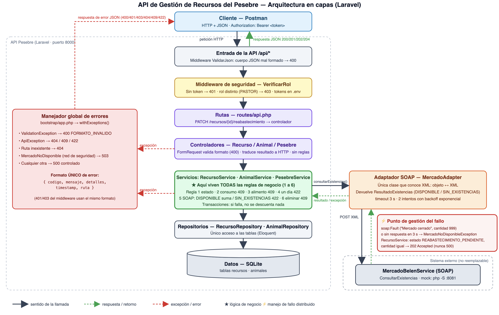

# API de Gestión de Recursos del Pesebre

API REST en **Laravel 13 (PHP 8.3+)** para administrar los recursos del pesebre (paja, mantas, agua, alimento y lámparas) y a sus animales. Se integra con el servicio SOAP heredado **MercadoBelenService** mediante un adaptador aislado (`MercadoAdapter`) y tolera sus caídas sin devolver nunca un 500.

## 1. Cómo levantar el proyecto

Requisitos: PHP ≥ 8.3 con extensiones `pdo_sqlite`, `curl`, `xml` y Composer.

```bash
git clone <url-del-repo> api-pesebre && cd api-pesebre
composer install
cp .env.example .env
php artisan key:generate
touch database/database.sqlite          # en Windows: type nul > database\database.sqlite
php artisan migrate:fresh --seed        # crea tablas y datos de ejemplo
```

Abrir **dos terminales**:

```bash
# Terminal 1 — mock del servicio SOAP externo (MercadoBelenService)
php -S 127.0.0.1:8081 mock-soap/server.php

# Terminal 2 — la API
php artisan serve --port=8000
```

La API queda en `http://127.0.0.1:8000/api`.

## 2. Variables de entorno

| Variable | Ejemplo | Uso |
|---|---|---|
| `TOKEN_ENCARGADO_PESEBRE` | `encargado-demo-123` | Token del rol ENCARGADO_PESEBRE |
| `TOKEN_PASTOR` | `pastor-demo-456` | Token de otro rol (para probar 403) |
| `MERCADO_SOAP_URL` | `http://127.0.0.1:8081/MercadoBelenService` | URL del servicio SOAP |
| `MERCADO_TIMEOUT_SEGUNDOS` | `3` | Tiempo máximo de espera |
| `MERCADO_INTENTOS` | `2` | Intentos antes de declararlo caído |
| `MERCADO_BACKOFF_MS` | `200` | Espera base entre intentos (exponencial) |
| `PESEBRE_ZONA_HORARIA` | `America/Guayaquil` | Para la regla "una vez al día" |

El archivo `.env` **no se sube** al repositorio (está en `.gitignore`); solo se versiona `.env.example`.

## 3. Usuarios / tokens de prueba

Enviar el token en el header `Authorization: Bearer <token>`.

| Rol | Token de prueba | Resultado en endpoints protegidos |
|---|---|---|
| ENCARGADO_PESEBRE | `encargado-demo-123` | Permitido |
| PASTOR | `pastor-demo-456` | **403** Rol insuficiente |
| (sin token) | — | **401** |

## 4. Endpoints

| Método | Ruta | Seguridad | Reglas |
|---|---|---|---|
| POST | `/api/recursos` | ENCARGADO_PESEBRE | nombre único (409) |
| GET | `/api/recursos?categoria=&estado=` | Pública | |
| GET | `/api/recursos/{id}` | Pública | 404 |
| PATCH | `/api/recursos/{id}/consumo` | ENCARGADO_PESEBRE | 1, 2 |
| PATCH | `/api/recursos/{id}/reabastecimiento` | ENCARGADO_PESEBRE | 5 + fallos (202) |
| DELETE | `/api/recursos/{id}` | ENCARGADO_PESEBRE | 6 |
| POST | `/api/animales` | Pública | |
| GET | `/api/animales?especie=` | Pública | |
| PATCH | `/api/animales/{id}/alimentacion` | Pública | 3, 4 |
| GET | `/api/pesebre/resumen` | Pública | (opcional) |

**Mock SOAP** — según la cantidad pedida: `999` → `soap:Fault "Mercado cerrado"` · `998` → no responde en 3 s (timeout) · `≥ 500` → `SIN_EXISTENCIAS` · resto → `DISPONIBLE`.

**Formato único de error** (todas las respuestas 4xx/5xx):

```json
{ "codigo": "CONFLICTO_ESTADO", "mensaje": "…", "detalles": [], "timestamp": "2026-12-01T10:15:00Z", "ruta": "/api/recursos/7/consumo" }
```

## 5. Arquitectura



Diagrama: [`docs/arquitectura.png`](docs/arquitectura.png) (fuente editable: `docs/arquitectura.svg`).

```
Cliente (Postman)
  → ValidarJson (400) → VerificarRol (401/403)          app/Http/Middleware
  → Rutas                                               routes/api.php
  → Controladores (validan formato con FormRequest)     app/Http/Controllers, app/Http/Requests
  → Servicios  ★ reglas de negocio 1-6                  app/Services
      ├→ Repositorios → SQLite                          app/Repositories, app/Models
      └→ MercadoAdapter (único que conoce XML) → MercadoBelenService (SOAP)   app/Adapters
Manejador global de errores → JSON único                bootstrap/app.php, app/Support/ErrorResponse.php
```

- **Controladores**: solo reciben HTTP, delegan al servicio y arman la respuesta; no tienen reglas.
- **Servicios**: toda la lógica (estado automático, 409, 422, 202). Usan transacciones: si algo falla no se descuenta nada.
- **MercadoAdapter**: traduce objeto ↔ XML, aplica timeout de 3 s y 2 intentos con backoff. Ante `Fault` o timeout lanza `MercadoNoDisponibleException`; `RecursoService` la atrapa, deja el recurso en `REABASTECIMIENTO_PENDIENTE` sin cambiar la cantidad y responde **202 Accepted**.

## 6. Pruebas con Postman

Importar `postman/API-Pesebre.postman_collection.json` y ejecutarla en orden con el **Collection Runner** (la API y el mock deben estar levantados). Cubre 201/200, 400, 401, 403, 404, 409, 422 y 202 (SOAP caído); cada petición trae tests automáticos que validan también el formato único de error.

## 7. Análisis de microservicios

Dividiría el sistema en dos servicios. **Inventario**: recursos (nombre, categoría, cantidad, stock mínimo, estado), consumo, reabastecimiento y el adaptador del Mercado de Belén. **Establo**: animales (especie, ración, última alimentación) y la regla de alimentar una vez al día. Cada uno tendría su propia base de datos; Establo pediría a Inventario descontar alimento mediante una API.

Si Inventario cayera el 24 de diciembre a las 23:00, Establo seguiría listando y registrando animales, pero no podría alimentarlos: con timeout y circuit breaker respondería 503 controlado (o encolaría la alimentación para confirmarla después), sin marcar al animal como alimentado. Si cayera Establo, Inventario seguiría operando con normalidad.
